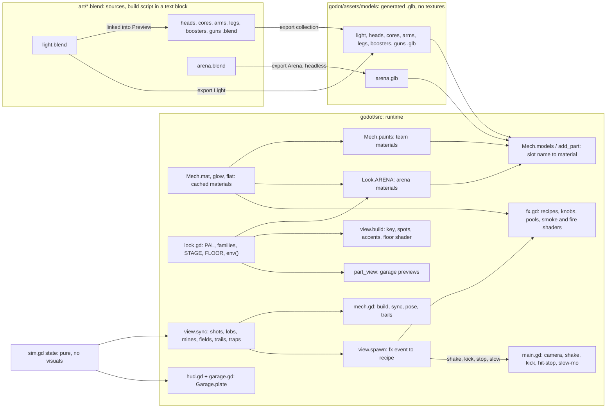

# Visual Architecture

How the look is built, what depends on what, and the rules for changing it. Target look:
`art-direction.md`. Current state and numbers: `visual-audit.md`.

## Files

| File | Owns |
|---|---|
| `godot/main.tscn` | one `Main` node; everything else is created in code |
| `godot/src/main.gd` | game camera (follow, close-ups, shake, kick), hit-stop, slow-mo, look-check flags, screenshots |
| `godot/src/look.gd` | palette `PAL`, material families, light rig and tonemap knobs `STAGE`, floor values `FLOOR`, arena slot materials `ARENA`, `env()` for the arena and the garage |
| `godot/src/view.gd` | WorldEnvironment, light placement (key, follow spots, accents), floor shader, walls, stands and crowd, arena props, projectiles, traps, the effect dispatch `spawn`, danger zone, reticle |
| `godot/src/mech.gd` | material helpers (`mat`, `glow`, `flat`), mesh helpers, `.glb` loading (`models`, `add_part`), team colors (`TEAM`, `TEAM_LIGHT`, `TEAM_DARK`, `EYES`, `CORE_C`, `BOOST_C`), mech build and animation |
| `godot/src/fx.gd` | effect recipes, one knob dict each, particle layers, smoke and fire shaders, node pools |
| `godot/src/hud.gd`, `garage.gd` | HUD and garage UI; shared plate style `Garage.plate`; UI colors |
| `godot/src/part_view.gd` | garage 3D previews: own world, camera-fixed light, `Look.env(true)` |
| `art/<name>.blend` | text block `<name>_build.py` builds the export collection; the `Preview` collection is for fit checks only |
| `godot/assets/models/<name>.glb` | generated meshes; their material slot names are the contract with the code |
| `FX_DESIGN.md` | effects spec |

## Dependency map

## Contracts

- **Material slots by name.** Every material name in a `.glb` must exist in the dict passed to
  `Mech.add_part`, or loading fails. Mech parts: `body`, `trim`, `joint`, `gem`, `boost`, `core`,
  `glow`, `heal`, `flame`, `laser`, `arc`, `bounce` → `Mech.paints`. Arena: `steel`, `dark`,
  `trim`, `hazard`, `amber`, `zap`, `pad`, `heal`, `vent` (stadium-polish adds `aisle`,
  `concrete`, `flood`, `icon`, `led_a/b/n`, `roof`, `screen`, `seat_a/b/n`, `tread`) →
  `Look.ARENA`. A new slot = the name in the build script and in the dict, in the same change.
- **Origins are pivots.** An object's position in the `.glb` is its pivot in its parent's space
  (legs in hips space, cores in chest space, boosters on the chest's back face, guns at elbow,
  fist or shoulder pad).
- **Axes and units:** 1 unit = 1 m; +X = forward / barrel / face for parts; sim (x, y) →
  `Vector3(x, height, y)`.
- **Names:** never end a part in `_wheel` (Godot imports it as a `VehicleWheel3D`). Import
  suffixes are on.
- **Import settings** (every `.glb`): LODs, shadow meshes and tangents on, static light baking.
  Per-file changes need a reason in the commit.
- **The sim is never touched for looks.** Sizes it knows (pillar radius, pad radius, trap spots,
  walls) come from `sim.gd`; the view scales meshes to them. The golden hash must not move.
- **Effects come from sim events only:** `state.fx` entries, `act` states, shots, lobs, trails.
  `view.spawn` maps `f.k` to an `Fx` recipe. A new fx kind also needs a `RECIPES` row in
  `sfx.gd`, or `sound_test` fails.
- **Player-facing text** goes through `i18n.gd`, English and Spanish in the same edit.

## Effects library

Each recipe has one knob dict at the top of `fx.gd`: `HIT`, `BOOM`, `RAY`, `ARC`, `MUZZLE`,
`PARRY`, `BREAK`, `KO`, `LAND`, `DASH`, `RIPPLE`, `HOOKED`, `EMP`, `BLINK`, `HEAL`, `SOAK`,
`MAGNET`, `CRUSH`, `PING`, `CHARGE`, `KICK`, `RIBBON`, `SMOKE`, `CONE`. One-shot pieces are pooled
(`Fx.take` / `Fx.park`: bars, spare emitters, damage numbers, dash ghosts); long-lived emitters
(wreck smoke, missile trails, break smoke) are not. Particles are `CPUParticles3D`. Missing: a cap
on live effects; add one only if profiling shows spikes.

## Asset pipeline

For every new or changed asset:

1. **Brief** (in the milestone notes): purpose, size from the sim, silhouette, material slots
   (families from `art-direction.md`), collision owner (always the sim; meshes never collide).
2. **Edit the build script** in the `.blend`'s text block. One function per object, shared helpers
   within the script, no hand-modelled edits that the script would wipe.
3. **Build, save and export, headless, in one call:**
   `& $B -b art\<name>.blend --python tools\blender_export.py -- --build --save`. It runs the
   `<name>_build.py` text block, saves the `.blend` (sources stay in `art/`; `*.blend1` backups
   are git-ignored), then exports the `<Name>` collection to `godot/assets/models/<name>.glb`
   with the default glTF settings. Without `--build` it only exports; `--out <path>` writes
   elsewhere. It turns the collection's viewport switch on first: a hidden collection exports
   stale positions and loses every pivot. All 9 `.blend` files reproduce their current `.glb`
   this way (M0).
4. **Import:** `--headless --import`; read the log for errors.
5. **Wire** new slot names in code (one dict entry per name).
6. **Look:** look check at the game camera and a close-up; compare with the last shot.
7. **Check:** no new errors, `.glb` triangle count against its budget, no duplicate materials,
   all tests pass.

Godot-native beats Blender when it's simpler: floor detail, markings and wear go in shaders;
stencil text can be a flat `Label3D`; rings and markers are primitive meshes.

## Visual foundation (Milestone 1)

`godot/src/look.gd`, data first:

- `PAL`: the palette tokens from `art-direction.md`.
- `FAMILY` (metallic, roughness per family) and `paint(family, color)`, which calls `Mech.mat`
  so the cache still shares materials; emissives call `Mech.glow` with a `PAL` color.
- `ARENA`: arena slot name → material, read by `view.gd` and the garage stand.
- `STAGE`: tonemap, glow, ambient, key, follow spots and accent lights. `FLOOR`: the floor
  shader's uniforms, set by name.
- `env(clear)`: the Environment for both `view.gd` and `part_view.gd`. It asserts
  `glow_threshold ≥ fx_peak × exposure`, because Godot 4.7 multiplies the glow input by exposure
  (and glow strength) before the threshold (`copy.glsl`, glow first pass).
- Shared shader code for metal wear, when Milestone 2 needs it.

Light rig in `view.build`: the key is the only shadow caster, high and behind the camera (the
camera never rotates, so the key's shine never reflects into it); 4 unshadowed follow spots;
unshadowed cyan and orange omni accents at the pillar bases, the wall corners and the heal pad.
No haze, no reflection probe yet (M2, once there is something bright to reflect).

`Mech.TEAM` and the other team colors stay in `mech.gd`: they are mech identity, used by the HUD,
the crowd and the effects, and moving them buys nothing.

## Tools

| Tool | Command (PowerShell, from `games/mech-duel`) |
|---|---|
| Look check | `& $G --path godot --resolution 1920x1080 -- --autopilot --seed=3 --shot=<abs>.png --at=700 [--cam=4]` |
| Effects sandbox | `& $G --path godot -- --seed=3 --sandbox=<weapon> --shot=<abs>.png --at=<tick>` (M1 stills: `laser` at 55, `mortar` at 160, `mortar --norefill` at 602 for the K.O.) |
| Perf probe | `& $G --path godot --resolution 1920x1080 -s "$PWD\tools\perf_probe.gd" -- --autopilot --seed=3` → one `PERF …` line after ~40 s |
| Look numbers | `python tools\look_stats.py docs\reference\industrial-neon-arena.webp <shot>.png …` (`--palette` adds the 12 main colors) |
| Side by side | `python tools\side_by_side.py <out>.png "Reference=docs\reference\industrial-neon-arena.webp" "M0=<shot>.png" "M1=<shot>.png" + <next row …>` |
| Blender build + export | `& $B -b art\<name>.blend --python tools\blender_export.py -- [--build] [--save] [--out <path>]` |
| Tests | `& $G --headless --path godot -s res://tests/<name>_test.gd` for `sim_rules`, `garage_parts`, `sound`, `hype` |

`$G` = `C:\Users\victo\Tools\Godot\Godot_v4.7.2-stable_win64_console.exe`,
`$B` = `C:\Users\victo\Tools\Blender\blender-5.2.3-windows-x64\blender.exe`. The perf probe
needs an absolute path after `-s`.
