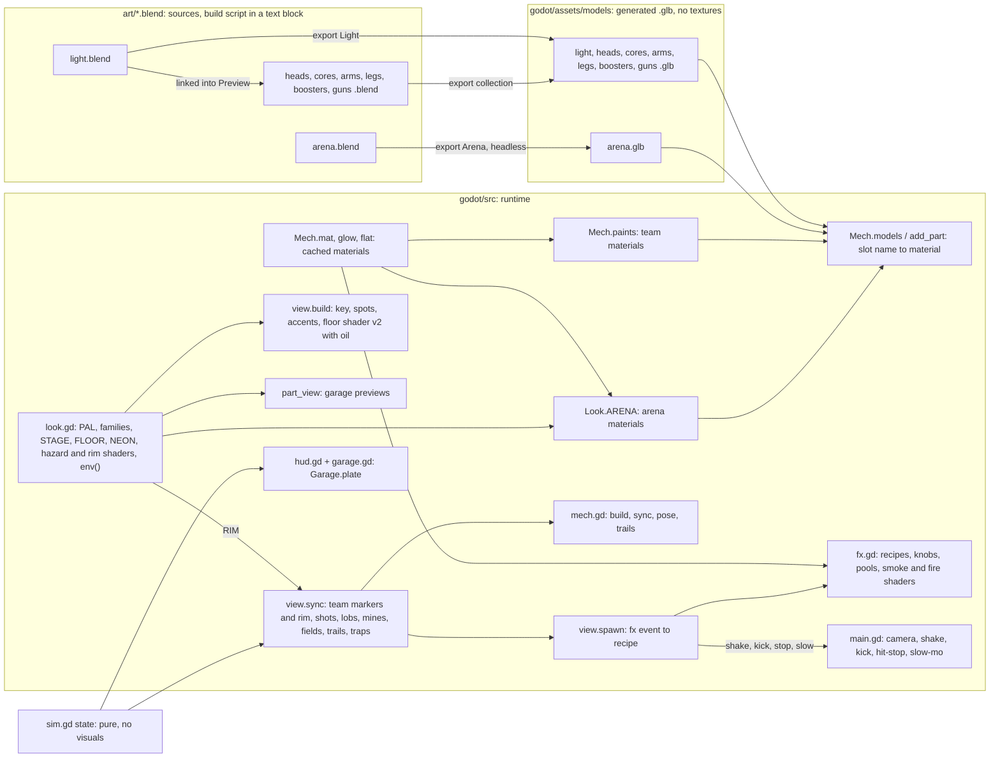

# Visual Architecture

How the look is built, what depends on what, and the rules for changing it. Target look:
`art-direction.md`. Current state and numbers: `visual-audit.md`.

## Files

| File | Owns |
|---|---|
| `godot/main.tscn` | one `Main` node; everything else is created in code |
| `godot/src/main.gd` | game camera (follow, close-ups, shake, kick), hit-stop, slow-mo, look-check and sandbox flags, screenshots |
| `godot/src/look.gd` | palette `PAL`, material families, light rig and tonemap knobs `STAGE`, floor values `FLOOR`, light level `NEON` and `neon()`, hazard stripes `HAZARD` + `HAZARD_SHADER`, mech rim `RIM` + `RIM_SHADER`, shader noise `NOISE`, `shader()`, arena slot materials `ARENA`, `env()` for the arena and the garage |
| `godot/src/view.gd` | WorldEnvironment, light placement (key, follow spots, accents), floor shader v2 (plates, hazard bands, edge line, spawn chevrons, oil slicks), walls, stands and crowd, arena props, team markers (`MARK`, `mark()`: ring, ▼, rim), projectiles, traps, the effect dispatch `spawn`, danger zone, reticle |
| `godot/src/decor.gd` | atmosphere (M4): scorch marks, wall-base grime, floor grates, metal scraps, floating dust; knobs `D`, keep-out test `clear()`, placements `spots()` |
| `godot/src/mech.gd` | material helpers (`mat`, `glow`, `flat`), mech surface knobs `SKIN` and team paint `paints()`, mesh helpers, `.glb` loading (`models`, `add_part`), team colors (`TEAM`, `TEAM_LIGHT`, `TEAM_DARK`, `EYES`, `CORE_C`, `BOOST_C`), mech build and animation |
| `godot/src/fx.gd` | effect recipes, one knob dict each, particle layers, smoke and fire shaders, node pools |
| `godot/src/hud.gd`, `garage.gd` | HUD and garage UI; shared plate style `Garage.plate`; UI colors |
| `godot/src/part_view.gd` | garage 3D previews: own world, camera-fixed light, `Look.env(true)` |
| `art/<name>.blend` | text block `<name>_build.py` builds the export collection; the `Preview` collection is for fit checks only |
| `godot/assets/models/<name>.glb` | generated meshes; their material slot names are the contract with the code |
| `FX_DESIGN.md` | effects spec |

## Dependency map

## Contracts

- **Material slots by name.** Every material name in a `.glb` must exist in the dict passed to
  `Mech.add_part`, or loading fails. Mech parts: `body`, `trim`, `joint`, `gem`, `boost`, `core`,
  `glow`, `heal`, `flame`, `laser`, `arc`, `bounce` → `Mech.paints`. Arena: `steel`, `dark`,
  `trim`, `hazard`, `amber`, `zap`, `pad`, `heal`, `vent`, `strip` (stadium-polish adds `aisle`,
  `concrete`, `flood`, `icon`, `led_a/b/n`, `roof`, `screen`, `seat_a/b/n`, `tread`) →
  `Look.ARENA`. A new slot = the name in the build script and in the dict, in the same change.
- **Floor shader arrays match the sim.** `FLOOR_SHADER` has fixed array sizes, filled from
  `sim.gd` in `build_floor`: `rings[10]` = `PADS` + `SPAWNS`, `boxes[4]` = the crushers,
  `walls[8]`, `spawns[2]`, `oils[2]`. A change in one of those counts changes the shader's array
  size in the same edit.
- **Origins are pivots.** An object's position in the `.glb` is its pivot in its parent's space
  (legs in hips space, cores in chest space, boosters on the chest's back face, guns at elbow,
  fist or shoulder pad).
- **Axes and units:** 1 unit = 1 m; +X = forward / barrel / face for parts; sim (x, y) →
  `Vector3(x, height, y)`.
- **Names:** never end a part in `_wheel` (Godot imports it as a `VehicleWheel3D`). Import
  suffixes are on.
- **Import settings** (every `.glb`): LODs, shadow meshes and tangents on, static light baking.
  Per-file changes need a reason in the commit.
- **The sim is never touched for looks.** Sizes it knows (pillar radius, pad radius, trap spots,
  walls) come from `sim.gd`; the view scales meshes to them. The golden hash must not move.
- **Mech overlays are the rim.** `view.mark` sets `material_overlay` on every `.glb` part of a
  match mech (the ones without a `material_override`) to that mech's rim. Another overlay on a
  mech part would replace it. Dash afterimages (`Fx.ghost`) copy the mech, so they clear it.
- **Team markers float on their own.** The ring and the ▼ are `top_level`, placed by `view.sync`
  from the sim (ring on the floor, ▼ over `Sim.height_of`), so a K.O. tilt never moves them and
  afterimages skip them. They and the rim switch off while `Sim.hidden` is true (smoke).
- **Effects come from sim events only:** `state.fx` entries, `act` states, shots, lobs, trails.
  `view.spawn` maps `f.k` to an `Fx` recipe. A new fx kind also needs a `RECIPES` row in
  `sfx.gd`, or `sound_test` fails.
- **Player-facing text** goes through `i18n.gd`, English and Spanish in the same edit.

## Effects library

Each recipe has one knob dict at the top of `fx.gd`: `HIT`, `BOOM`, `RAY`, `ARC`, `MUZZLE`,
`PARRY`, `BREAK`, `KO`, `LAND`, `DASH`, `RIPPLE`, `HOOKED`, `EMP`, `BLINK`, `HEAL`, `SOAK`,
`MAGNET`, `CRUSH`, `PING`, `CHARGE`, `ULT`, `FIELD`, `KICK`, `RIBBON`, `SMOKE`, `CONE`. One-shot pieces are pooled
(`Fx.take` / `Fx.park`: bars, spare emitters, damage numbers, dash ghosts); long-lived emitters
(wreck smoke, missile trails, break smoke) are not. Particles are `CPUParticles3D`. Missing: a cap
on live effects; add one only if profiling shows spikes.

## Asset pipeline

For every new or changed asset:

1. **Brief** (in the milestone notes): purpose, size from the sim, silhouette, material slots
   (families from `art-direction.md`), collision owner (always the sim; meshes never collide).
2. **Edit the build script** in the `.blend`'s text block. One function per object, shared helpers
   within the script, no hand-modelled edits that the script would wipe.
3. **Build, save and export, headless, in one call:**
   `& $B -b art\<name>.blend --python tools\blender_export.py -- --build --save`. It runs the
   `<name>_build.py` text block, saves the `.blend` (sources stay in `art/`; `*.blend1` backups
   are git-ignored), then exports the `<Name>` collection to `godot/assets/models/<name>.glb`
   with the default glTF settings. Without `--build` it only exports; `--out <path>` writes
   elsewhere. It turns the collection's viewport switch on first: a hidden collection exports
   stale positions and loses every pivot. All 9 `.blend` files reproduce their current `.glb`
   this way (M0).
4. **Import:** `--headless --import`; read the log for errors.
5. **Wire** new slot names in code (one dict entry per name).
6. **Look:** look check at the game camera and a close-up; compare with the last shot.
7. **Check:** no new errors, `.glb` triangle count against its budget, no duplicate materials,
   all tests pass.

Godot-native beats Blender when it's simpler: floor detail, markings and wear go in shaders;
stencil text can be a flat `Label3D`; rings and markers are primitive meshes.

## Visual foundation (Milestone 1)

`godot/src/look.gd`, data first:

- `PAL`: the palette tokens from `art-direction.md`.
- `FAMILY` (metallic, roughness per family) and `paint(family, color)`, which calls `Mech.mat`
  so the cache still shares materials; arena lights call `neon()` with a `PAL` color (M2).
- `ARENA`: arena slot name → material, read by `view.gd` and the garage stand.
- `STAGE`: tonemap, glow, ambient, key, follow spots and accent lights. `FLOOR`: the floor
  shader's uniforms, set by name.
- `env(clear)`: the Environment for both `view.gd` and `part_view.gd`. It asserts
  `glow_threshold ≥ fx_peak × exposure`, because Godot 4.7 multiplies the glow input by exposure
  (and glow strength) before the threshold (`copy.glsl`, glow first pass).
- `NOISE`: hash, noise and fbm, shared by the floor and hazard shaders (M2).

Light rig in `view.build`: the key is the only shadow caster, high and behind the camera (the
camera never rotates, so the key's shine never reflects into it); 4 unshadowed follow spots;
unshadowed cyan and orange omni accents at the pillar bases, the wall corners, the heal pad and
over the oil slicks. No haze and no reflections: a reflection probe and screen-space reflections
were both tried in M2 and neither showed at the game camera.

`Mech.TEAM` and the other team colors stay in `mech.gd`: they are mech identity, used by the HUD,
the crowd and the effects, and moving them buys nothing.

## Arena (Milestone 2)

- **Lights:** arena lights are `Look.neon(color, NEON.x)`: a black surface that only emits, at
  energy 0.75. Under AgX a brighter or lit emissive turns near white (saturation ~0.3) and stops
  reading as cyan or orange. Keep new arena lights on `neon()` and check them with
  `look_stats.py` (neon = saturation > 0.5 and value > 0.6).
- **Hazard stripes:** `Look.ARENA.hazard` is a shader, not paint: 45° yellow and black stripes in
  world space, chipped by noise. Any `hazard` surface gets them, so model plain bands, not stripe
  geometry. A per-instance warning duplicates it and sets `warn` (the crushers).
- **Floor v2:** one shader for the ground: plates and seams, tint, polish, grime, hazard bands
  around pads, spawns and crushers, the dashed edge line, the spawn chevrons and the oil slicks
  (`grime`, glossy, thin-film rim). Positions and the oil radius come from `sim.gd`. It runs on
  most of the screen, so costly parts branch on distance (the oil fbm runs only near a slick).
- **Floor rings:** pillars, tesla towers and the heal pad carry a thin cyan `strip` ring on the
  floor at their base, in their mesh.

## Robots (Milestone 3)

- **Surfaces:** `mech.gd` `SKIN` sets metal and roughness per slot (body paint 0.35 / 0.4, steel
  trim 0.75 / 0.35, joints 0.6 / 0.55). The `glow` slot is a team-color light on a black base at
  0.9, the same trick as the arena's `neon()`; before M3 it was `TEAM_LIGHT` at 1.6, which AgX
  turned near white. These are shared with the garage previews.
- **Rim:** `look.gd` `RIM_SHADER`, an additive overlay. Each mech pixel looks 2 px out in 8
  directions in the depth texture; where the scene behind is more than 0.6 m farther (floor,
  props), it adds the team color. So the rim follows the outer silhouette at a fixed pixel width
  and skips the edges where the mech's own parts overlap. Godot's `rim` property was tried first:
  it lights faces seen edge-on, and the mechs' flat faces are never seen that way from the game
  camera, so it changed nothing. Match only: the garage previews have no rim. Headless runs skip
  it too (`DisplayServer.get_name()`): Godot's headless renderer logs "Parameter material is null"
  for a depth-reading overlay. Cost: 0.24 ms GPU and 81 draw calls for two mechs.
- **Markers:** `view.gd` `MARK`: a ring on the floor (radius 0.9–1.12 m, wider than the arena's
  thin pad rings) and a ▼ 0.75 m wide, 2.9 m up, both `Mech.flat` (unshaded, normal blend) in the
  team color darkened by 30 %. Unshaded keeps them out of the light rig; normal blend keeps the
  floor from tinting them.
- **Wind-up bar:** `mech.gd` `aim_line` is `Mech.flat(SKIN.aim, true)`, additive like the
  effects, so it can no longer bloom.
- **Buff auras** (2026-10-27): `mech.gd` `AURA` and `aura()`. `build` makes one hidden holder per
  lasting R skill (Overdrive, Berserk, Deflect on the mech, Mirror on the torso so it turns with
  the aim); `sync` shows the ones whose `m.buffs` key is above 0. Holders carry the `aura` meta,
  and `Fx.ghost` skips them. A new lasting R skill with a `buffs` key gets an aura the same way.
  The body no longer takes a buff tint: the team color stays readable.
- **R skill release** (2026-10-27): every R skill sends `ult` when it fires; `view.spawn` plays
  `Fx.ult`. Fields (`field_stasis`, `field_well`), the Bastion wall and the mines are built in
  `view.make` from `Mech.flat` (no glow), field knobs in `Fx.FIELD`.

## Atmosphere (Milestone 4)

- **One file, built once:** `view.build` calls `Decor.build(self)` right after the floor. Knobs in
  `decor.gd` `D`. `spots()` places every piece from a fixed seed (`D.seed`), so every match and
  every still shows the same arena; the view's own `randf` is never used.
- **Keep-out:** `Decor.clear(p, r)` keeps a piece of footprint radius `r` at least `D.keep`
  (1.5 m) off the visible edge of every pad and the heal pad (hazard band, 1.4 m), each spawn
  (its chevrons reach 4.7 m), each crusher (band, 2.0 m, square), each tesla's reach, each EMP
  vent strip and each oil slick, all read from `sim.gd`. `garage_parts_test`
  (`decor_keeps_off_pads_spawns_and_traps`) re-checks every placement with those numbers. The
  shrinking wall's late-match zone is not a keep-out: it covers the outer 18 m.
- **Floor pieces:** one `MultiMeshInstance3D` of 1 m planes and one shader (`SHADER`, `look.gd`
  `NOISE`), per-instance custom data = kind (0 scorch, 1 grime, 2 grate), a seed and the grate's
  half size. Scorch: a dark core and spiky edge from noise on the direction, plus flecks
  (`grime` → `void`, family Scorched). Grime: a band along each wall, darkest at the wall, only
  where `clear()` allows (corners and between vents). Grates: on 4 m plate centers, `steel` rim
  and grid over `void` slots, opaque. Alpha-blended, no shadows, 2 cm above the floor.
- **Scraps:** a second multimesh of small boxes around each scorch, `Look.ARENA.trim`, static.
- **Dust:** one `CPUParticles3D`, pale `steel_hi` specks 0.6–4 m up over the whole arena, slow,
  unshaded, normal blend (never blooms), fixed seed. `tools/arena_shot.gd` hides it with the
  effects. Nothing decorative moves on the floor.
- **No reflections to tune:** M2 left out the probe and SSR, so M4's "reflection strength" has
  nothing to act on.

## Tools

| Tool | Command (PowerShell, from `games/mech-duel`) |
|---|---|
| Look check | `& $G --path godot --resolution 1920x1080 -- --autopilot --seed=3 --shot=<abs>.png --at=700 [--cam=4]` |
| Effects sandbox | `& $G --path godot -- --seed=3 --sandbox=<weapon> --shot=<abs>.png --at=<tick>` (M1 stills: `laser` at 55, `mortar` at 160, `mortar --norefill` at 602 for the K.O.; M3: `rivet --ult` at 30 for the lance wind-up) |
| Perf probe | `& $G --path godot --resolution 1920x1080 -s "$PWD\tools\perf_probe.gd" -- --autopilot --seed=3` → one `PERF …` line after ~40 s |
| Arena-only still | `& $G --path godot --resolution 1920x1080 -s "$PWD\tools\arena_shot.gd" -- --autopilot --seed=3 --tick=700 --out=<abs>.png [--top]` (effects and the wind-up bar hidden; bright is measured here; `--top` = the whole arena, no HUD) |
| Look numbers | `python tools\look_stats.py docs\reference\industrial-neon-arena.webp <shot>.png …` (`--palette` adds the 12 main colors) |
| Side by side | `python tools\side_by_side.py <out>.png "Reference=docs\reference\industrial-neon-arena.webp" "M0=<shot>.png" "M1=<shot>.png" + <next row …>` |
| Blender build + export | `& $B -b art\<name>.blend --python tools\blender_export.py -- [--build] [--save] [--out <path>]` |
| Tests | `& $G --headless --path godot -s res://tests/<name>_test.gd` for `sim_rules`, `garage_parts`, `sound`, `hype` |

`$G` = `C:\Users\victo\Tools\Godot\Godot_v4.7.2-stable_win64_console.exe`,
`$B` = `C:\Users\victo\Tools\Blender\blender-5.2.3-windows-x64\blender.exe`. The perf probe
and the arena-only still need an absolute path after `-s`.
